# System architecture and data flow

## Architecture

Gesture Room is a client-side single-page application. Vite serves the React/TypeScript frontend; there is no application server or backend API.

| Area | Responsibility |
| --- | --- |
| `src/App.tsx` | Composes the presentation UI, webcam lifecycle, hand tracking, and gesture actions. |
| `src/context/AppContext.tsx` | Shares the current slide index and gesture/camera settings. |
| `src/components/Slideshow.tsx`, `Slide.tsx` | Renders slide content, transitions, keyboard navigation, controls, and fullscreen action. |
| `src/components/WebcamPreview.tsx` | Displays mirrored camera video and paints detected landmarks on a canvas. |
| `src/components/SettingsPanel.tsx`, `OnboardingModal.tsx`, `GestureToast.tsx` | Provides configuration, gesture help, and action feedback. |
| `src/hooks/useWebcam.ts` | Requests camera permission, reports camera errors, and stops media tracks during cleanup. |
| `src/hooks/useHandTracker.ts` | Loads the MediaPipe Hand Landmarker in VIDEO mode, runs the animation-frame detection loop, and closes it on cleanup. |
| `src/hooks/useGestureRecognizer.ts` | Turns normalized hand landmarks into slide, fullscreen, and image-zoom actions, applying the configured cooldown. |
| `src/lib/gestureUtils.ts` | Holds pure distance, pinch, swipe, and hand-pose helpers. |
| `src/data/slides.ts` | Defines the presentation content and optional image URLs. |

Camera frames and landmarks are processed in the browser. The app does fetch the MediaPipe runtime/model, web fonts, and configured slide images from external URLs; it does not send webcam frames to an application backend.

## Data-flow diagram

```mermaid
flowchart LR
    User[Presenter]
    Settings[Settings panel]
    State[AppContext<br/>slide index + settings]
    Slides[slides.ts<br/>presentation data]
    Deck[Slideshow + Slide]
    Keyboard[Arrow-key handler]
    Webcam[useWebcam<br/>getUserMedia]
    Video[Mirrored video preview]
    Tracker[useHandTracker<br/>MediaPipe VIDEO]
    Landmarks[Normalized hand landmarks]
    Overlay[Landmark canvas overlay]
    Recognizer[useGestureRecognizer]
    Utils[gestureUtils<br/>swipe / pinch / poses]
    Actions[Slide / fullscreen / zoom actions]
    Feedback[Gesture toast]
    Browser[Browser fullscreen API]

    User -->|← / →| Keyboard
    Keyboard -->|navigate| State
    User -->|gesture controls| Settings
    Settings -->|camera, sensitivity, cooldown| State
    State -->|camera enabled| Webcam
    Webcam -->|MediaStream| Video
    Webcam -->|MediaStream| Tracker
    Video -->|video frames| Tracker
    Tracker -->|landmarks| Landmarks
    Landmarks --> Overlay
    Landmarks --> Recognizer
    Recognizer --> Utils
    Utils -->|recognized gesture| Actions
    Actions -->|index / zoom| State
    Actions -->|fullscreen| Browser
    Actions --> Feedback
    State --> Deck
    Slides --> Deck
```

## Gesture action mapping

| Recognition | App action |
| --- | --- |
| Wrist moves left across the recent sample window | Next slide |
| Wrist moves right across the recent sample window | Previous slide |
| Open palm held for 1 second | Toggle browser fullscreen |
| Closed fist held for 1 second | Return to the first slide |
| Thumb and index finger pinch | Adjust the current slide image zoom |

The configured cooldown applies to discrete gesture actions to prevent repeated slide/fullscreen triggers. Pinch updates image zoom continuously while the pinch is held.
